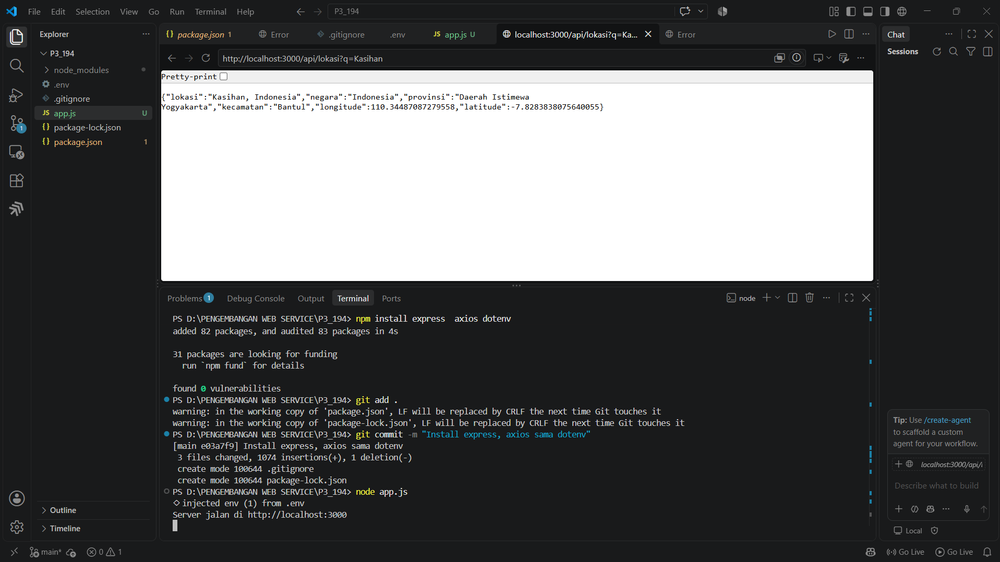
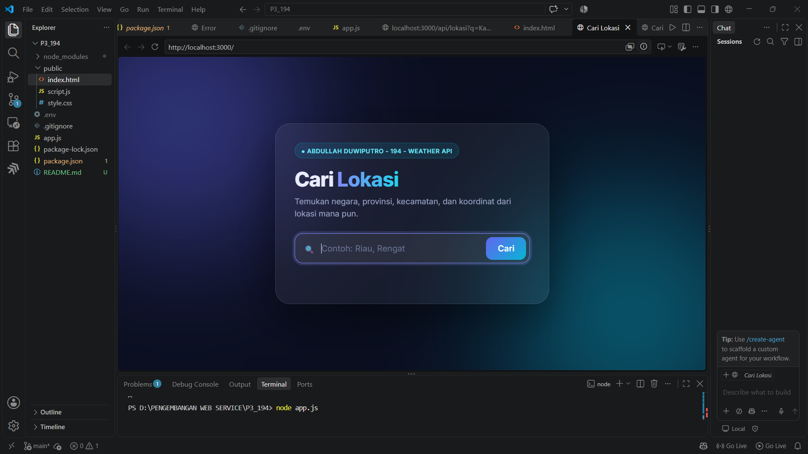
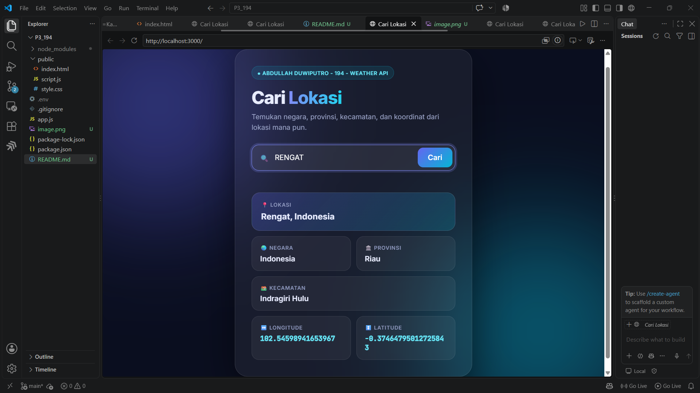

# Praktikum 2 - Weather API

Aplikasi Express + axios untuk mencari lokasi lewat MapTiler Geocoding API.

## Cara menjalankan
1. `npm install`
2. Buat file `.env` berisi `MAPTILER_KEY=XBB6Z7SDjE9KOvGocGP1`
3. `node app.js`
4. Buka http://localhost:3000

## Screenshot hasil GET

